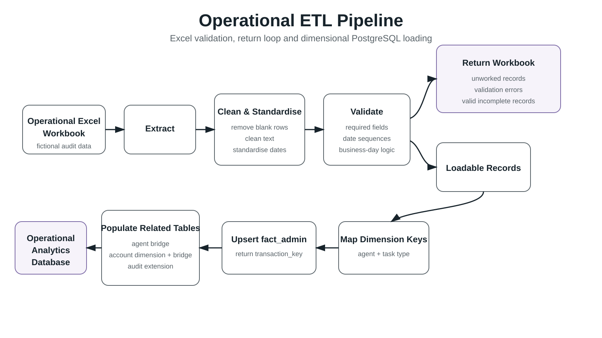

# Operational ETL Pipeline

A Python ETL workflow for validating operational Excel data, returning incomplete or invalid records for review, and loading clean records into a dimensional PostgreSQL database.

## Project Context

This project builds on the operational data mart designed in the first part of the project.

The source data originated in Excel workbooks used by an operational Customer Services team. These files were designed around day-to-day working processes rather than database requirements, which meant they could contain missing values, inconsistent text, incomplete cases and multiple account numbers within individual rows.

The aim was to create a repeatable ETL process that could validate operational data, support data-quality review and load structured records into the analytical database.

## ETL Workflow

The pipeline follows four main stages:

1. Extract and standardise operational workbook data
2. Validate records and return incomplete, unworked or invalid rows for review
3. Resolve dimensional surrogate keys
4. Load validated records into the dimensional PostgreSQL model



## Extract

The pipeline reads the operational Excel workbook into a Pandas DataFrame and records the initial dimensions of the source data.

It then:

- removes completely blank rows
- preserves the workbook UUID as `transaction_id`
- separates unworked cases
- standardises text values
- standardises date fields
- calculates missing completion times using business-day logic

## Validate and Return

Each record is checked for missing required values and inconsistent date sequences.

Validation failures are recorded in an `errors` column so that the reason for each issue is visible to operational users.

A separate return workbook is then created containing:

- unworked records
- records with validation errors
- valid records that are still incomplete

The original source workbook is left untouched.

This allows the return process to support operational review without modifying the working source file.

## Loadable Records

Records without validation errors continue through the database-loading workflow.

Valid but incomplete records are still eligible for loading, allowing management information to capture work in progress as well as completed activity across a reporting period.

## Dimensional Key Mapping

The pipeline queries the PostgreSQL database to resolve existing dimensional keys.

For the audit workflow, this includes:

- agent keys from `dim_agent`
- task-type keys from `dim_task_type`

These surrogate keys are then attached to the validated source records before loading.

## Database Loading

The pipeline loads records in a defined sequence so that foreign-key relationships remain valid.

### Administrative Fact Table

Validated records are inserted or updated in `fact_admin`.

The source `transaction_id` is used as the conflict key, allowing existing records to be updated whilst preserving their database surrogate key.

### Agent Bridge

Each administrative transaction is linked to its allocated agent through `bridge_admin_agent`.

If the allocation changes, the relationship is updated.

### Account Dimension

Rows containing multiple account numbers are split into individual account records.

New accounts are inserted into `dim_account`, whilst existing account records are reused through the account-number key.

### Account Bridge

Transactions are linked to one or more accounts through `bridge_admin_account`.

Existing transaction-account relationships are left unchanged.

### Audit Extension

Audit-specific information is loaded into `ext_fact_admin_audits`, including:

- audit or change-of-auditor classification
- request description
- returned-case notes

## Results

The finished pipeline created a standardised route from operational Excel workbooks into the PostgreSQL analytical database whilst partially automating a previously manual review process.

Ten workflow-specific ETL scripts were created using the same overall pattern, with minor differences for workflow-specific extension-table fields.

This repository contains the audit workflow as a representative implementation.

## Repository Structure

```text
operational-etl-pipeline/
├── README.md
├── src/
│   └── audit_etl_pipeline.py
├── sample_data/
│   ├── README.md
│   └── fake_audit_logging_spreadsheet.xlsm
├── images/
│   └── etl_pipeline_flow.svg
├── requirements.txt
├── .env.example
└── .gitignore
```

## Configuration

Database credentials are supplied through environment variables rather than being stored in the script.

The expected variables are:

```text
DB_HOST=
DB_PORT=5432
DB_NAME=
DB_USER=
DB_PASSWORD=
```

The actual `.env` file should not be committed to Git.

## Requirements

The project uses:

- Python
- Pandas
- NumPy
- SQLAlchemy
- OpenPyXL
- Psycopg
- PostgreSQL

Install the required Python packages with:

```bash
pip install -r requirements.txt
```

## Sample Data

The example workbook uses a real business-process structure with fictional data to demonstrate the ETL pipeline and its interaction with the operational data mart.

No real customer or operational data is included in this repository.

## Key Learnings

- ETL is as much about controlling bad data as moving good data.
- ETL design and database design need to be developed together.
- Returning incomplete records to users can make validation part of the operational workflow rather than simply rejecting bad data.
- Load sequencing matters when working with dimensional models, bridge tables and foreign-key constraints.

## Related Project

This ETL pipeline loads data into the dimensional PostgreSQL data mart developed in the first part of the project.
